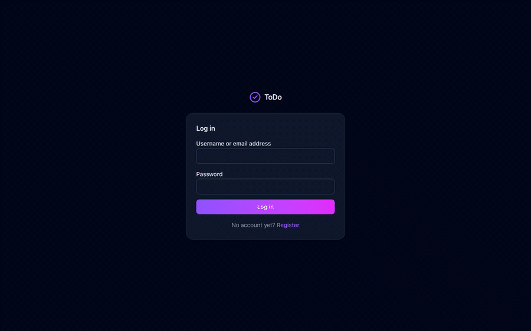

# spring-boot-todolist

**REST API + React SPA** 構成の ToDo アプリケーションです。Spring Boot の単体多モジュール
（Modular Monolith）が JSON を返し、UI は独立した Vite の SPA が担当します。

The English version is at [README.md](README.md).

| | |
|--|--|
| バックエンド | Java 21, Spring Boot 4.0.1, Spring Security 7, Spring Data JPA, Flyway, PostgreSQL |
| フロントエンド | React 19, TypeScript, Vite, Tailwind CSS, axios, lucide-react, sonner |
| 認証 | ステートレス JWT（HS384） |
| ドキュメント | [ER](docs/ER.md) · [FLOW](docs/FLOW.md) · [DESIGN](docs/DESIGN.md) · [MANUAL](docs/MANUAL.md) · [TESTING](docs/TESTING.md) · [SEED](docs/SEED.md) · [CI/CD](docs/CICD.md) |
| 要件 | [task.md](task.md) |
| ライブデモ | [Codespacesで開く](#ライブデモ) — またはローカルで2分 |
| マニュアル | [MANUAL](docs/MANUAL.md) — 画面ごとの操作手順と15秒のデモ |

---

## ユーザー体験



画面は1つだけです。登録・仕分け・編集・検索のすべてをダッシュボード上で行います。
タスクを1件追加するのに画面遷移が必要なTODOアプリは、結局使われなくなるためです。

**ビューは「置き場所」ではなく「条件」です。** 受信箱・今日・今後・期限切れは、
タスクを振り分けるフォルダではなく、タスクに対する述語として定義されています。
だから整理しなくても正しい場所に現れ、5つのビューがデータと食い違うことがありません。

**2つのスイッチ、4つの象限。** タスクは「緊急」と「重要」を独立して持ち、
アイゼンハワーの象限はその組み合わせから導出されます。同期すべき象限フィールドはありません。

**黙って壊すことはしません。** 削除は必ず確認してから論理削除します。
プロジェクトを削除しても、中のタスクは受信箱に戻るだけで消えません。

### 視覚言語

| | |
|--|--|
| パレット | 面と文字は Tailwind の `slate`。各画面で1つだけの主要アクションに violet→fuchsia のグラデーション |
| 優先度 | `emerald` 低 ・ `amber` 中 ・ `rose` 高。バッジとカード左端のストライプの両方で表現 |
| 象限 | 破線の枠。`rose` Do ・ `violet` Schedule ・ `amber` Delegate ・ `slate` Eliminate |
| ダークモード | `<html>` に `.dark` を付け外しする手動トグル。ブラウザごとに記憶し、OS設定には追従しない |
| 文字 | システムフォント。件数は `tabular-nums` で、更新時に数字が揺れないようにしている |
| アイコン | lucide-react、16px。必ずテキストラベルと併記する |

色だけで意味を伝えることはありません。優先度バッジも象限も名前を文字で持つため、
色が判別できなくても一覧は読めます。

### 応答のしかた

| 場面 | UIの振る舞い |
|--|--|
| 読み込み中 | スピナーではなく、実際の行と同じ形のスケルトン |
| 空のとき | 白紙ではなく、次に何をすればよいかを示す空状態 |
| 成功 | 右下のトースト。変更したばかりのタスク一覧に重ならない位置 |
| 失敗 | サーバーのメッセージをそのまま表示。入力エラーの理由がそのまま分かる |
| 破壊的操作 | 毎回かならず確認ダイアログ |
| 進捗 | チェックを入れた瞬間に当日の進捗が更新される |

設計の根拠と画面一覧は [DESIGN.md](docs/DESIGN.md) §5、操作手順は
[MANUAL.md](docs/MANUAL.md) にあります。

---

## ライブデモ

[](https://codespaces.new/NweNweWinThan-X/spring-boot-todolist)

> **このアプリをホスティングしているサーバーはありません。** どこにもデプロイしていないため、
> 他人のマシン上で動く公開URLは存在しません。上のボタンが最も近いもので、ブラウザ上の環境に
> 一式を構築します。下の手順はローカルで動かす方法です。どちらも最初からデモデータが入っています。

### 方法A — ブラウザだけ、インストール不要

バッジをクリックすると、GitHub Codespaces が
[`.devcontainer/devcontainer.json`](.devcontainer/devcontainer.json) から環境
（JDK 21、Node 22、npm パッケージ）を構築します。あとはターミナルで2つ実行するだけです。

```bash
./mvnw spring-boot:run -Dspring-boot.run.profiles=h2   # ターミナル1
npm --prefix frontend run dev                           # ターミナル2
```

ポート5173は自動で転送され、プレビューが開きます。SPA は Vite の開発プロキシ `/api` 経由で
API を呼ぶため、自動生成される `*.app.github.dev` のホスト名を API の CORS 許可リストに
加える必要はありません。

GitHubアカウントが必要で、そのアカウントの Codespaces 無料枠を消費します。ホスティングされた
ページではなく実際の開発環境なので、初回の構築には数分かかります。

### 方法B — 自分のマシンで2分

```bash
git clone https://github.com/NweNweWinThan-X/spring-boot-todolist.git
cd spring-boot-todolist
```

```bash
# ターミナル1 — API を :8080 で起動。インメモリH2、環境変数は不要
./mvnw spring-boot:run -Dspring-boot.run.profiles=h2
```

```bash
# ターミナル2 — SPA を :5173 で起動
npm --prefix frontend install && npm --prefix frontend run dev
```

<http://localhost:5173> を開いてログインします。

| | |
|--|--|
| ユーザー名 | `demo` |
| パスワード | `Demo1234!` |

このアカウントには3つのプロジェクトと4つのラベルにまたがる19件のタスクが入っています。
期限切れ・今日・今後・受信箱・3種類のステータス・アイゼンハワーの4象限が、開いた時点で
すべて埋まるように配置してあります。もう1つのアカウント `alex`（パスワード同じ）は、
アカウント間でデータが見えないことを確認するためのものです。詳細は [SEED](docs/SEED.md)。

プロセスの外には何も書き込みません。`h2` プロファイルはすべてメモリ上に置き、
サーバーを止めると破棄します。

> **ポートが固定なのは意図的です。** SPA は `http://localhost:8080/api/v1` を呼び、
> API の CORS 許可リストには `:3000` と `:5173` しかありません。どちらかを変えると噛み合わなくなります。

---

## ローカル起動手順

### 前提

| ツール | バージョン |
|--|--|
| JDK | 21 |
| Node.js | 20 以上 |
| PostgreSQL | 16 以上 |

```bash
createdb todolist
cp .env.example .env     # DB_PASSWORD を設定する
```

| 環境変数 | 用途 |
|--|--|
| `DB_URL` | 未設定時は `jdbc:postgresql://localhost:5432/todolist` |
| `DB_USERNAME` / `DB_PASSWORD` | 接続情報（必須） |
| `JWT_SECRET` | Base64 の 256 ビット以上の署名鍵。未設定なら起動ごとに生成するため、再起動で発行済みトークンは無効になる |
| `APP_ADMIN_USERNAME` / `APP_ADMIN_PASSWORD` / `APP_ADMIN_EMAIL` | `local` / `h2` プロファイルの初回起動時に管理者を作成する |

### 1. バックエンド起動

```bash
./mvnw spring-boot:run -Dspring-boot.run.profiles=local
```

環境変数なしで起動でき、デモデータが最初から入っているプロファイルが2つあります。
ログインは `demo` / `Demo1234!` です。

```bash
./mvnw spring-boot:run -Dspring-boot.run.profiles=dev   # ローカルのPostgreSQL、環境変数不要
./mvnw spring-boot:run -Dspring-boot.run.profiles=h2    # インメモリ、DBのインストール不要
```

`.env` を読むのは `docker compose` だけで、Spring Boot は読みません。詳細は
[SEED](docs/SEED.md) を参照してください。

起動時に Flyway がマイグレーションを適用します。API は `http://localhost:8080` で待ち受けます。

### 2. フロントエンド起動

別のターミナルで実行します。

```bash
cd frontend
npm install
npm run dev
```

SPA は `http://localhost:5173` で起動します。CORS は `:5173` と `:3000` の両方を許可している
ため、`npm run dev -- --port 3000` でも動作します。接続先は `VITE_API_BASE_URL` で変更できます。

### PostgreSQL を使わない場合

`h2` プロファイルはインメモリ H2 を使い、Flyway を無効化して `ddl-auto: update` でスキーマを
構築し、`/h2-console` を公開します。デプロイ環境では使用しません。

```bash
SPRING_PROFILES_ACTIVE=h2 ./mvnw spring-boot:run
```

---

## API

ベースパスは `/api/v1` です。登録とログイン以外は `Authorization: Bearer <token>` が必要です。

| メソッド | パス | 内容 |
|--|--|--|
| `POST` | `/auth/register` | アカウント登録。トークンとユーザー要約を返す |
| `POST` | `/auth/login` | 認証してトークンを返す |
| `GET` | `/auth/me` | 保存済みトークンからセッションを復元する |
| `GET` | `/tasks` | タスク一覧（絞り込み・ページング） |
| `GET` | `/tasks/progress` | 指定日の達成状況 |
| `GET` | `/tasks/{id}` | タスク1件 |
| `POST` | `/tasks` | 作成（`201` + `Location`） |
| `PUT` | `/tasks/{id}` | 全項目更新 |
| `PATCH` | `/tasks/{id}/status` | ステータスのみ更新 |
| `DELETE` | `/tasks/{id}` | 論理削除（`204`） |
| `GET` `POST` `PUT` `DELETE` | `/projects`, `/projects/{id}` | プロジェクト CRUD |
| `PATCH` | `/projects/{id}/archived?archived=` | アーカイブ／復帰 |
| `GET` `POST` `PUT` `DELETE` | `/labels`, `/labels/{id}` | ラベル CRUD |

### タスク一覧のクエリパラメータ

| パラメータ | 値 |
|--|--|
| `view` | `ALL` `INBOX` `TODAY` `OVERDUE` `UPCOMING` |
| `status` | `PENDING` `IN_PROGRESS` `COMPLETED` |
| `priority` | `LOW` `MEDIUM` `HIGH` |
| `projectId`, `labelId` | ID（数値） |
| `urgent`, `important` | 真偽値。両方指定でアイゼンハワー・マトリクスの1象限を選択する |
| `from`, `to` | `YYYY-MM-DD` 形式の期限範囲 |
| `search` | タイトルに対する大文字小文字を区別しない部分一致 |
| `sortBy` | `id` `title` `status` `priority` `dueDate` `startTime` `createdAt` `updatedAt` |
| `direction` | `ASC` `DESC` |
| `page`, `size` | 0 始まりのページ番号、サイズ上限 100 |

### エラーレスポンス

すべての失敗は同一の形式で返します。

```json
{
  "timestamp": "2026-10-10T01:23:45.678Z",
  "status": 400,
  "error": "E0400",
  "message": "リクエストの内容が正しくありません。",
  "path": "/api/v1/tasks",
  "fieldErrors": { "title": "must not be blank" }
}
```

タスクは常に認証済みユーザーに紐付けて検索します。他人のタスクを指定した場合は、行の存在を
明かさないために 403 ではなく **404** を返します。

---

## リポジトリ構成

```text
spring-boot-todolist/
├─ src/main/java/com/todolist/
│  ├─ modules/
│  │  ├─ auth/      アカウント、JWT 発行、認証ユーザー解決
│  │  ├─ project/   タスクを束ねる生活領域
│  │  ├─ label/     再利用可能なメタデータ
│  │  └─ task/      タスク本体
│  └─ shared/       config, domain, exception, log, security, web
├─ src/main/resources/db/migration/   Flyway
├─ frontend/        React + TypeScript の SPA
├─ docs/            ER, FLOW, DESIGN, TESTING, SEED, CI/CD
├─ .claude/         このリポジトリで Claude Code が使うスキル
├─ .husky/          Git フック
├─ Dockerfile  docker-compose.yml  Makefile
└─ task.md          フェーズ別のビルド要件
```

各モジュールは `domain / dto / repository / service / controller` で構成します。モジュールは
`shared` には依存しますが、相互には依存しません。唯一の例外は `task` が `project` と `label`
を参照する点で、逆方向はドメインイベントを経由します。

---

## 規約

コーディング規約とレビュー基準は `.claude/skills/` にあります。

| スキル | 内容 |
|--|--|
| `java-clean-code` | 例外・Controller・Service・DTO の規約、パッケージ構成、`java-code-style.md`、`jpa-best-practices.md` |
| `java-code-review` | 差分に対するレビュー |
| `security-audit` | OWASP 観点のセキュリティ診断 21 項目 |
| `commit` | 日本語コミットメッセージの生成 |

主要な規約の抜粋：

- 例外は `AppException` + `AppErrorCode` を使用し、`IllegalArgumentException` /
  `RuntimeException` / 裸の `.orElseThrow()` は使わない
- Controller にビジネスロジック・リポジトリ注入・`try-catch` を書かない（`ApiExceptionHandler`
  が処理する）
- Service は `@Transactional(readOnly = true)` を既定とし、書き込みメソッドで上書きする
- 読み取りは DTO プロジェクションまたはエンティティグラフを使い、エンティティを API に露出しない
- インデントは半角スペース 2、1行は 100 文字以内、公開 API には Javadoc

---

## ビルドとテスト

```bash
./mvnw clean verify              # コンパイル、バックエンド32テスト、パッケージング
cd frontend && npm run build     # 型チェックとバンドル
cd frontend && npm run test:e2e  # Playwright 22テスト（両サーバーの起動が必要）
```

手動テストの手順・シナリオ・スクリーンショットは [TESTING](docs/TESTING.md) を参照してください。

---

## デプロイ

```bash
make build    # Docker イメージをビルド
make deploy   # ビルド＋再デプロイ
make up       # コンテナ起動
make down     # コンテナ停止
make logs     # アプリログ表示
make exec     # app コンテナに入る
make clean    # 未使用イメージ削除
```

| サービス | ポート |
|--|--|
| `web` — SPA を配信する nginx | 9001 |
| `app` — REST API | 9002 |
| `db` — PostgreSQL 17 | 9432 |

`DB_PASSWORD` と `JWT_SECRET` は必須で、未設定の場合 `docker compose` は起動しません。
SPA の API URL はビルド時にバンドルへ埋め込まれるため、変更時は `.env` の `API_BASE_URL` を
設定して `web` イメージを再ビルドしてください。詳細は [CI/CD](docs/CICD.md) を参照。

### ブランチ保護

`.husky/pre-push` は `develop` / `release` への直接プッシュを拒否します。`.husky/pre-commit`
はコミット前にバックエンドをコンパイルします。フックはリポジトリ直下の `npm install` で
有効化されます。

## CI/CD

GitHub Actions が push と pull request のたびにバックエンドテスト・フロントエンドビルド・
Playwright・Docker ビルドを実行します。`v*` タグで API と SPA のイメージを GHCR に公開します。
詳細は [CI/CD](docs/CICD.md) を参照してください。
