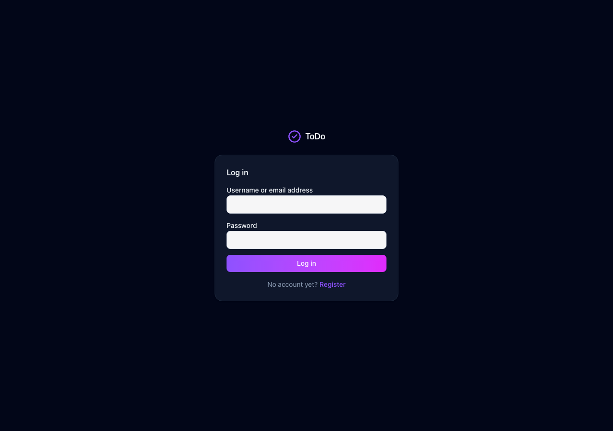
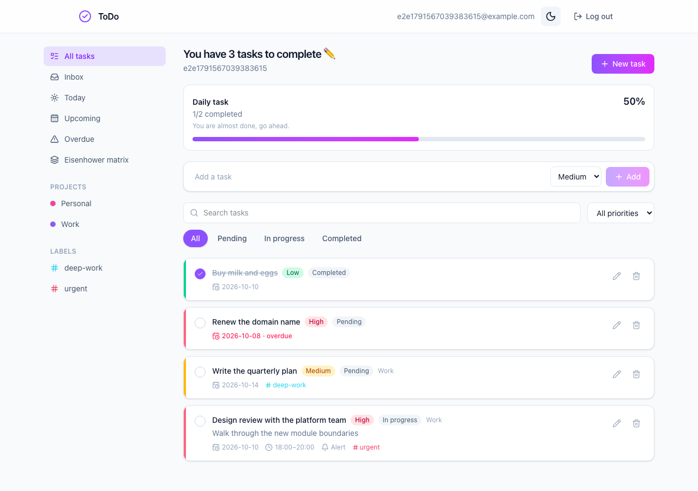
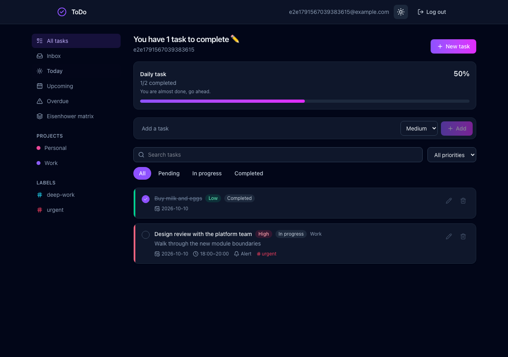
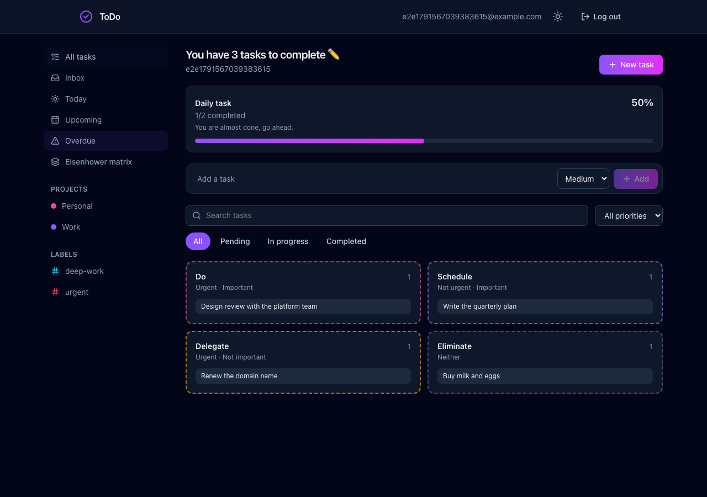
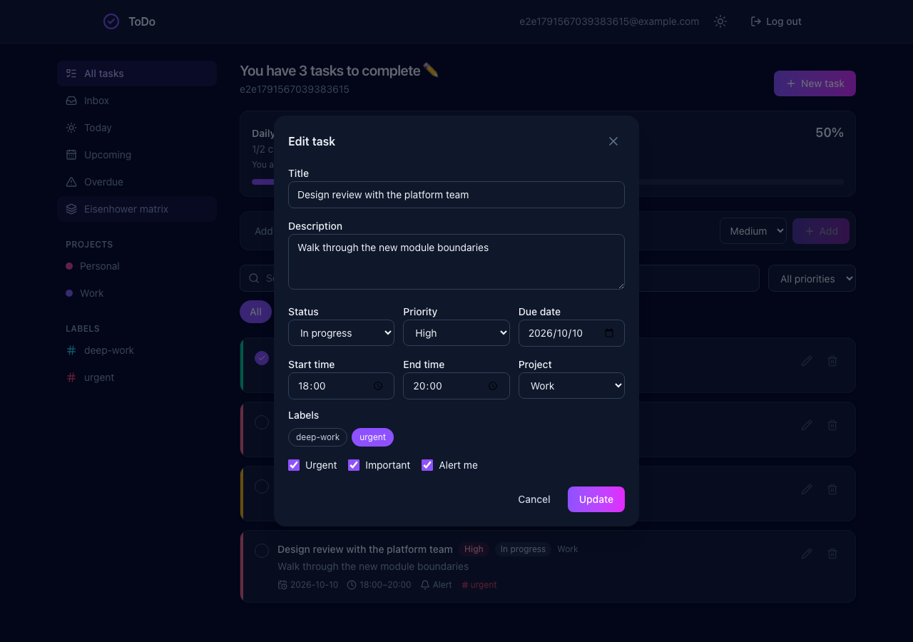
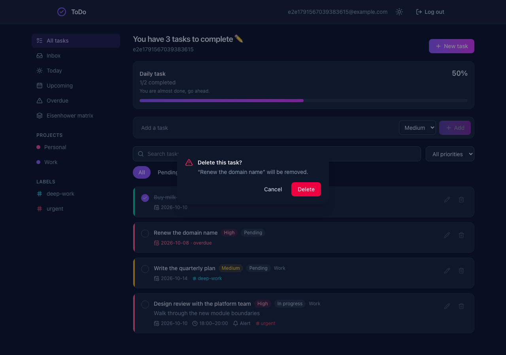
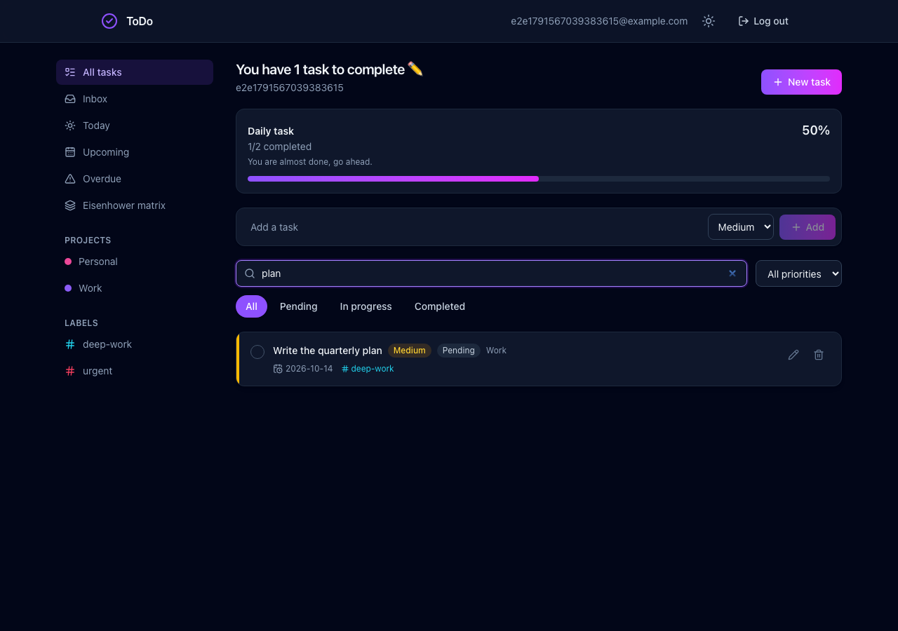
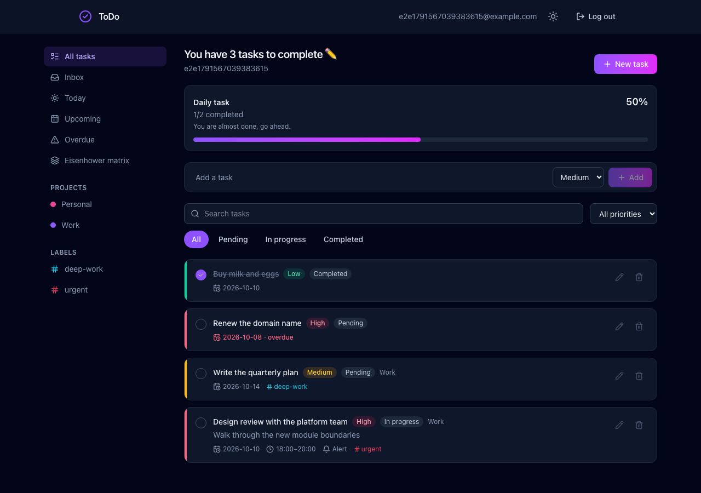
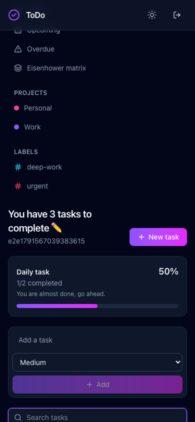

# MANUAL — System manual

How to use the application, screen by screen. This is the user guide; if you are verifying
that the system behaves correctly rather than learning to drive it, read
[TESTING.md](TESTING.md) instead, which covers the same features as test procedures.


*Sign in, the five views, the Eisenhower matrix, adding and completing a task, the editor,
search, and the theme toggle — the whole system in 15 seconds.*

---

## 1. Signing in

| | |
|--|--|
| Demo account | `demo` / `Demo1234!` |
| Second account | `alex` / `Demo1234!` — exists to show that accounts cannot see each other |

Both arrive with the seed data described in [SEED.md](SEED.md). To start empty instead, use
**Register**: the username is 3–50 characters of `A–Z a–z 0–9 . _ -`, the password at least 8.

You can sign in with either the username or the email address — the field accepts both.



**Your session lasts 24 hours.** The token is held in browser storage, so closing the tab keeps
you signed in and **Log out** clears it. One caveat for developers: if `JWT_SECRET` is unset the
server generates a new signing key on every start, so restarting the API signs everyone out.

---

## 2. The dashboard



Four regions, left to right and top to bottom:

| Region | What it does |
|--|--|
| **Sidebar** | The five views, then your projects and labels. Selecting one narrows everything to the right of it |
| **Progress card** | How many of *today's* tasks are done. It tracks today only, so it reads 0/0 on a day with nothing due |
| **Quick add** | A title and a priority — the fastest way to capture something. Everything else can be filled in later |
| **Task list** | The current view, filtered by the search box, the priority dropdown and the status tabs |

The heading counts what is still open in the current view, so it changes as you switch views.

---

## 3. The five views

These are **derived from your tasks, not stored**, so they cannot be renamed or deleted and a
task never has to be filed into one.

| View | Shows |
|--|--|
| **All tasks** | Everything not deleted |
| **Inbox** | Tasks with no project — the default home for anything quick-added |
| **Today** | Due today |
| **Upcoming** | Due between today and seven days from now, today **included** |
| **Overdue** | Past due **and** not yet completed |

 

Two consequences worth knowing, because they surprise people:

- A task due today appears in **both** Today and Upcoming. Upcoming is a seven-day window that
  starts today, not "after today".
- Completing an overdue task removes it from **Overdue** immediately — that view deliberately
  excludes completed work — but it stays in All tasks with a line through it.

"Today" means today in the **server's** timezone, not the browser's.

---

## 4. The Eisenhower matrix



Each task carries two independent switches, **Urgent** and **Important**, and the quadrant is
derived from the pair. You never choose a quadrant directly.

| | Important | Not important |
|--|--|--|
| **Urgent** | **Do** — now | **Delegate** — hand off |
| **Not urgent** | **Schedule** — plan it | **Eliminate** — drop it |

The matrix respects whatever view you are in. Open it while **Inbox** is selected and you see
only inbox tasks arranged by quadrant. It is a toggle that replaces the list, so click
**Eisenhower matrix** again to go back.

---

## 5. Adding, editing, completing, deleting

**Quick add** takes a title and a priority. The task lands in the Inbox with no due date.

**New task** opens the full editor for everything else:



| Field | Notes |
|--|--|
| Title | Required, up to 200 characters |
| Description | Optional, up to 2000 |
| Status | Pending, In progress, Completed |
| Priority | Low, Medium, High |
| Project | Optional — leaving it empty means Inbox |
| Labels | Any number, reusable across tasks |
| Due date | Optional |
| Start / end time | Optional, but an end time must be **after** its start time |
| Alert | A reminder flag stored with the task |
| Urgent / Important | The two matrix switches |

**The checkbox on a card** toggles completion and updates the progress card at once.
**Delete asks first** — the task is soft-deleted, so it disappears from every view but is not
erased from the database.



---

## 6. Finding things



Search matches the title and description of tasks in the current view, and stacks with the
priority dropdown and the status tabs. Three filters, one list — if a search returns nothing,
check whether a status tab or a project is still selected.

---

## 7. Projects and labels

**Projects are exclusive**: a task belongs to one, or to none (Inbox). Use them for areas of
life that do not overlap — Work, Personal, Study.

**Labels are not**: a task can carry as many as you like. Use them for anything that cuts
across projects — `office`, `deep-work`, `errand`.

Both take a colour, and both are per-account. Archiving a project hides it without touching its
tasks.

**Deleting a project does not delete its tasks.** They fall back to the Inbox. This is
deliberate — losing work because a container was removed is rarely what anyone wants.

---

## 8. Theme and small screens

The sun/moon button in the navbar switches between light and dark, and the choice is remembered
in the browser.

 

Below roughly 1024px the sidebar moves above the list and the matrix stacks into one column.

---

## 9. When something looks wrong

| Symptom | Cause |
|--|--|
| Sent back to the login screen | The 24-hour token expired, or the API restarted with no fixed `JWT_SECRET` |
| A task vanished after you edited the due date | It moved out of the view you are in — check **All tasks** |
| Today and the progress card disagree with your clock | They use the server's timezone |
| "End time must be after start time" | The validation is server-side; the browser does not pre-check it |
| Empty list after searching | A status tab or project filter is still active alongside the search |

Error responses follow one shape across the whole API, so a failure shows a readable message
rather than a stack trace. The codes are listed in [DESIGN.md](DESIGN.md).

---

## 10. Regenerating the walkthrough

`demo.gif` is captured from the running application, not drawn by hand, so it cannot drift away
from the real UI. With the API and the SPA running and the demo seed loaded:

```bash
cd frontend
npm run demo
```

That runs [`e2e/demo-video.spec.ts`](../frontend/e2e/demo-video.spec.ts) to capture 20 frames,
then [`scripts/make-demo-gif.py`](../frontend/scripts/make-demo-gif.py) to assemble them into a
15-second GIF with Pillow — no ffmpeg needed, and a GIF because GitHub will not play a `.webm`
committed to a repository.

The capture signs in as `demo`, adds one task and removes it again at the end, so it leaves the
seed data exactly as it found it and can be run repeatedly. Its title contains
"documentation screenshots", which is how CI excludes it from the normal suite.
